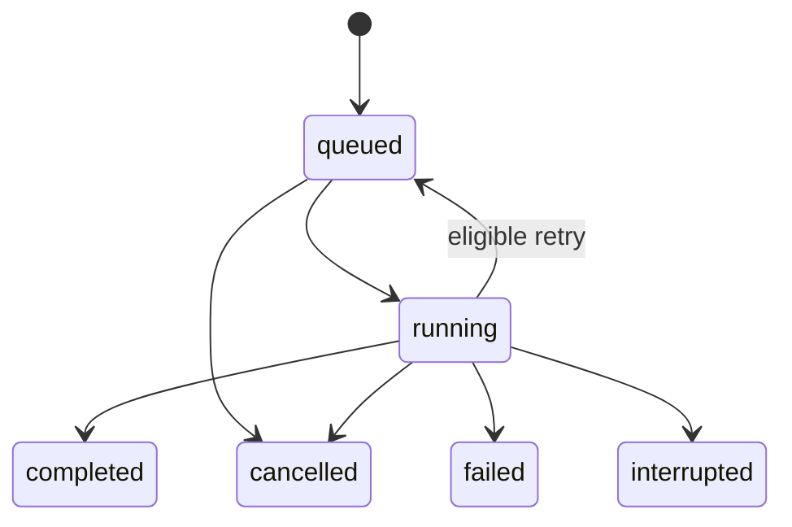

# Cutbolt agent interface (v0.4)

Optional [foreground masks](SEGMENTATION.md) use a separate local CLI producer. Its scene results, including per-frame matte identities, are accepted by typed `scene.inspect`; no network service or additional MCP tool is introduced.

The existing `scene.inspect` tool accepts optional typed [geometry](GEOMETRY.md), reporting sampled cameras/lights, world matrices and bounded work. Rendering remains the blocking local scene command.

`expression.inspect` is a read-only typed MCP tool accepting a scene and rational sample times. It reports exact node values and rounded position/opacity bindings without media access or file writes. See [expressions](EXPRESSIONS.md) for limits, clocks and the distinction from complete scene compilation.

The ten foundational checks cover local commands, saved editing sessions, render job control and MCP stdio. Passing them does not validate every editing feature, operating system, failure mode or client. The tested environment is Windows with the narrow FFV1/PCM render profile. See [PROGRESS.md](PROGRESS.md) and [verification evidence](../verification/latest.json).

## Local background renders

For installation and a read-only setup check before starting MCP, see
[INSTALLATION.md](INSTALLATION.md). `cutbolt doctor` is a CLI command and does not enlarge the
MCP catalog.

Create an existing absolute local `job_root` outside the repository. It contains `jobs.sqlite3` and `worker.lock`, separate from the editing-session store. The queue migrates its own schema from version 1 to 2 transactionally; it does not migrate editing sessions. Do not delete or replace the lock file while workers run. Use trusted local storage with normal file locks, not network shares.

| Command | Arguments besides `command` | Result |
| --- | --- | --- |
| `render.start` | `job_root`, `request_id`, `render` containing `project`, `input_root`, `output_root`, `output`, optional `retry` | Stable ticket: `job_id`, `project_id`, `project_revision` |
| `job.status` | `job_root`, `job_id` | Saved state, cancellation flag, progress, result or error |
| `job.cancel` | `job_root`, `job_id` | Request cancellation; poll for a terminal state |
| `job.resume` | `job_root` | Wake a worker to drain queued work after restart |
| `job.start` | `job_root`, `request_id`, `run` (a long-running command), `arguments` (its arguments) | Stable ticket: `job_id`, `command` |
| `job.wait` | `job_root`, `job_id` or `job_ids` (up to 64) with optional `until` (`all`, the default, or `any`), optional `timeout_seconds` (1-120, default 30) | One job: the `job.status` view once it finishes or the wait ends, with `finished`. Several: `finished`, `until`, `counts` by status, and `jobs`, each with `job_id`, `command`, `status` and its `result`, `error` or `progress` |

`job.start` queues the long-running commands that are not direct MCP tools: `export.run`, `media.prepare`, `media.conform`, `scene.render`, `audio.render`, `audio.repair.render`, `hdr.conform`, `image.sequence.compile`, `proxy.generate`, `preview.range`, `cache.run` and `transcript.transcribe`. Its `arguments` are prepared and validated at submission exactly like a direct call. That includes workspace defaults, saved-project references and path-only identities, and an invalid argument fails immediately, named `arguments.<field>`. So does a missing output folder: `IO_ERROR` names it as `arguments.output: Output folder ... does not exist`. The job's result is the command's own receipt.

These jobs share the queue's request IDs, ticket replay, output reservation and 32-job limit. Each runs in its own process, inside a Windows job object or its own Linux process group, so it can be stopped as a whole:

- **Cancellation.** `job.cancel` stops a queued job at once and a running one within seconds. The command is told to stop: its tools are killed and its partial files removed. Anything still running 20 s later is terminated. The job ends `cancelled` with `JOB_CANCELLED`, unless its output was already published.
- **Watchdog.** A command whose processes together use less than 1 s of CPU in 180 s, without reporting progress, is stuck (a deadlocked tool sits at 0 %); it is stopped the same way and fails with `JOB_STALLED`. A command running longer than 12 hours fails with `JOB_TIMEOUT`. Neither publishes output.
- **Progress.** `progress` shows the command's phase and frames as it runs. `export.run` reports `inspecting`, `encoding` (frames converted and encoded straight from the timeline; two-pass encodes report `encoding pass 1` first) and `verifying` for H.264 video. Other profiles report `inspecting`, `rendering` (frames of the lossless reference), `verifying`, then `encoding` and `verifying` where they encode. `total_frames` is set to the exported frames. Commands that count no frames keep `frames` at 0.

An interrupted run is reported, not retried. Reference renders keep `render.start` with its retry and publication recovery.

A runnable example using a retained demo from `tests/integration.py`:

```powershell
$demo = 'C:\DEV\CutboltData\my-demo'
$queue = 'C:\DEV\CutboltData\jobs'
New-Item -ItemType Directory -Path $queue -Force | Out-Null
$project = Get-Content -Raw "$demo\project.json" | ConvertFrom-Json
$request = @{command='render.start'; job_root=$queue; request_id='export-demo-001'; render=@{
    project=$project; input_root="$demo\media"; output_root="$demo\output"; output="$demo\output\agent-export.mkv"
}}
$ticket = ($request | ConvertTo-Json -Depth 30 -Compress | .\target\debug\cutbolt.exe | ConvertFrom-Json).result
@{command='job.status'; job_root=$queue; job_id=$ticket.job_id} |
    ConvertTo-Json -Compress | .\target\debug\cutbolt.exe
# To stop unfinished work:
@{command='job.cancel'; job_root=$queue; job_id=$ticket.job_id} |
    ConvertTo-Json -Compress | .\target\debug\cutbolt.exe
```

Fetch a saved project with `session.get` at an explicit receipt revision to render a stable edit. Submission pins the snapshot and selected local FFmpeg/ffprobe paths and hashes. It does not freeze source media at submission time. Full inspection occurs in the worker; the first validated source manifest must match on every later attempt, in addition to the existing inspection/render checks.

### Scheduling, progress and cancellation

Jobs persist before a detached, hidden worker starts. They survive the submitting CLI or MCP connection closing. Up to 32 jobs per root may be queued or running. Additional submissions return `QUEUE_FULL`; an already committed request can still be replayed. Different roots have separate queues. Each submission also wakes the root's worker through a named event, and starts a standby worker that exits within 2 s when one is already running; an OS file lock grants only one ownership of the queue.

The worker runs independent jobs at once, up to `CUTBOLT_JOB_WORKERS` (default a quarter of the logical processors, 1 to 8), each on its own thread and store connection. Heavy jobs (exports, conversions, reviews, caption overlays, reference renders) hold half the pool, speech jobs run one at a time, and jobs that write the same path keep their submission order. [USAGE.md](USAGE.md#background-jobs) gives the rules. Status of concurrent jobs shows the same `worker_pid`.



Status also includes `attempts.current`, `attempts.maximum` and ordered status/error history. Progress restarts for each attempt. Status includes `progress.phase` (`queued`, `inspecting`, `rendering`, `verifying`, then the terminal state), `frames` and `total_frames`. The frame count measures encoding progress, not an overall percentage: verification can continue after all frames are encoded. No ETA is estimated. `worker_pid` is historical diagnostic metadata; do not use an old PID to manage a process.

Cancellation is checked during hashing, probing and encoding, approximately every 100 ms where the OS/tool is responsive. This is not a hard real-time latency guarantee. Each tool runs inside a Windows process scope established before the external executable starts. Terminating the wrapper stops its descendants; terminating the queue worker also stops its tool tree. Normal cancellation removes that job's partial file and releases the queue for subsequent jobs.

Publication and cancellation serialize through the job-store writer transaction. If cancellation wins, no final file is published. If publication wins, cancellation returns the completed state and leaves the output intact. Queued cancellation never starts a media process. Errors retain structured code/message information. Nothing silently overwrites an existing output or source.

### Retry, restart and limitations

- `request_id` is unique within a job root. Identical `render.start` retries return the original ticket, even after completion or interruption. Changed arguments with that ID fail with `REQUEST_ID_CONFLICT`.
- An active job reserves its output within the root. No-overwrite publication also protects outputs across roots and against unrelated writers.
- Add `retry: {"max_attempts": 2}` inside `render` to allow up to two attempts including the first; the accepted range is 1–3 and omission means one. Only transient tool failure/timeout or worker interruption can retry. Cancellation, changed media/tools and publication conflicts stop the job.
- If worker launch fails after saving, replay the same submission or use `job.resume`. The hidden worker inherits no caller handles, so a CLI reader can receive its ticket and EOF before the render finishes.
- `job.status`, `job.wait`, `job.cancel`, a new worker and `job.resume` reconcile abandoned running work: every job a dead worker was running, not just one. Eligible interrupted jobs become queued; `job.resume` starts a worker. Status inspection itself starts no worker. Completed, cancelled and exhausted jobs do not rerun.
- Before publication, a durable validated receipt records the expected output. Recovery accepts an existing file only when its content and saved receipt agree. A mismatch rejects and retains the file; a matching completed output can win simultaneous cancellation. See [the full recovery contract](RENDER_RECOVERY.md).
- A crash can leave `.cutbolt-job-<id>.partial.mkv` files. Later attempts use a different `.attempt-<number>.partial.mkv` suffix. Normal failure/cancellation cleans its own scratch file. Crash partials are retained; no orphan cleanup, mid-codec resume, job-history pruning or power-loss guarantee is provided.
- The background worker backend supports Windows and Linux. On Linux the worker runs in its own session. The tool wrappers it starts die with the thread that started them, and each external tool leads its own process group, watched by a small guardian. A queued command's process group is ended once the command exits, or after the grace period once its worker goes. So ending the worker, a job or a tool ends everything it started, as a Windows job object does. macOS and other platforms receive `UNSUPPORTED_PLATFORM`; synchronous rendering remains separate.

Rust embedders can call `commands::handle` or the library modules. Background jobs need the Cutbolt executable: set `CUTBOLT_EXECUTABLE` to its absolute path when embedding in a different executable. The CLI defaults to itself. No hosted API or network dependency is required.

## MCP over stdio

Launch `cutbolt.exe mcp`. The native adapter reads one JSON-RPC message per line and reserves stdout for protocol messages. EOF shuts down the adapter; submitted jobs continue. It negotiates `2025-11-25` or `2025-06-18`, supports initialize/initialized, ping, tools/list and tools/call, and advertises only tools. No resources, prompts, sampling, HTTP listener or MCP Tasks extension is advertised.

Clients load the whole tool catalog into model context. Bare `cutbolt mcp` now lists the compact catalog:

- **Direct tools.** Seventeen shared workflow and recovery tools: session create/get/apply/undo/history/receipt; job start/wait/status/cancel/resume; schema; files list; media inspect; timeline check; cache inspect/prune.
- **`cutbolt_run`.** One router runs the remaining tool commands with their usual arguments: `{"command":"audio.tighten","arguments":{...}}`. Its command enum gives exact names, and its description groups them by purpose. Prefer a direct tool when listed. Routed commands never delete files or cancel jobs; `job.cancel` and `cache.prune` are direct only. `cutbolt_schema` returns full argument descriptions.

The default `tools/list` response is **21,262 bytes**, or **21,104 bytes with a workspace** (compact UTF-8 JSON-RPC including newline). Tests cap each at 40,000 bytes and each tool at 4 KiB. Calls, images, progress and every command remain available. `--tools full` opts into all 86 direct tools, with their previous schemas and annotations. `CUTBOLT_MCP_TOOLS=full` or `core` also selects a catalog; an explicit flag wins. See [AGENT_COSTS.md](AGENT_COSTS.md) for the measured workflows and selection rationale.

Compact schemas omit the default dialect, summarize exact time shapes, and keep only the first clause of optional field descriptions (at most 120 characters). Required descriptions and full schema lookups retain their text. Time still uses the same strict parser and exact bounds. The [MCP schema rules](https://modelcontextprotocol.io/specification/2025-11-25/basic#schema-dialect) default to JSON Schema 2020-12. Compact annotations omit values equal to the [protocol defaults](https://modelcontextprotocol.io/specification/2025-11-25/schema#toolannotations): `readOnlyHint: false`, `destructiveHint: true`, `idempotentHint: false`; `openWorldHint: false` remains explicit. Wire tests and Python SDK 1.12.3 check both catalogs and effective hints. The SDK preserves absent hints as `None`; it does not itself apply the defaults. This does not certify every client host.

An example for clients accepting the common `mcpServers` configuration shape:

```json
{
  "mcpServers": {
    "cutbolt": {
      "command": "C:\\DEV\\Cutbolt\\target\\debug\\cutbolt.exe",
      "args": ["--workspace", "C:\\DEV\\CutboltData\\demo", "mcp"],
      "env": {
        "CUTBOLT_FFMPEG": "C:\\ffmpeg\\bin\\ffmpeg.exe",
        "CUTBOLT_FFPROBE": "C:\\ffmpeg\\bin\\ffprobe.exe"
      }
    }
  }
}
```

This example does not change any installed client. Client-specific formats may differ.

### Workspace

`--workspace DIR` (before `mcp`, or before a CLI request) or `CUTBOLT_WORKSPACE` fixes one existing directory as the boundary for every call. Omit it to keep explicit absolute roots on every request. With a workspace:

- **Omitted roots default inside it.** `input_root`, `output_root` and `media_root` are the workspace itself. `store_root`, `job_root`, `cache_root` and `scratch_root` are `.cutbolt/store`, `.cutbolt/jobs`, `.cutbolt/cache` and `.cutbolt/scratch`, created at startup. Tool schemas mark these fields optional and name their defaults. `capabilities` reports them under `workspace`.
- **Relative paths resolve against the workspace.** This covers roots, `output`, probed `path` values, relink `candidates`, the `path` of `media.relink` and `media.proxy.relink` operations, and a reference's `store_root`; `..` is rejected. Asset and identity paths already resolve under `input_root`, which is the workspace.
- **Explicit roots must lie inside the workspace,** checked after resolving links. Violations fail with `PATH_OUTSIDE_WORKSPACE` and the field name.
- **Paths the engine reports come back clean** on every platform. Output files and published assets (such as `media.prepare`'s `output` and `asset.path`, whether run directly or through `job.start`), probed sources and job receipts inside the workspace are reported relative to it with `/` separators (`.` for the workspace itself), and without the Windows `\\?\` prefix. They can be passed back as given: `registry.relink` and `proxy.relink` propose relative relink paths, which the workspace resolves when they are applied. A project snapshot's asset and proxy paths come back exactly as the caller wrote them.

Output directories must already exist, so write to the workspace root or to a folder you created. A missing one fails with `IO_ERROR` naming the folder and the `output_root` to create it in; the engine never creates it.

### Saved project references

Wherever a command takes a `project`, it also accepts `{"project_id": "...", "revision": N}`. The engine then loads that saved revision from the session store; omit `revision` for the current head. `store_root` inside the reference defaults to the workspace store; without a workspace, it is required. The loaded snapshot is used exactly as if it had been sent, including `expected_revision` checks and pinned render submissions. A missing project or revision fails with its usual code, and the message is prefixed with the field, for example `render.project:`. `session.create` takes a full snapshot or `id`, `width`, `height` and `frame_rate`, never a saved reference.

### Document files

In a workspace, a large document can move between calls as a file instead of through the agent's context:
- **Reading:** any argument given as `{"file": "scenes/title.json"}` is read from that JSON file inside the workspace. Add `"select": "scene"` to read just that field. `select` may also be a dotted path of fields and array indexes, such as `result.operations` or `cues.0`.
- **Writing:** `save_as: "scenes/title.json"` on a call writes its whole result to a new file and returns a summary: the path, its size and each top-level field's size. Existing files are never overwritten.

The document-producing tools, the proposals (`audio.duck`, `audio.normalize`, `audio.tighten`, `transcript.fillers`, `transcript.assemble`, `transcript.plan`) and `job.wait` list `save_as` in their schemas, but every command accepts it. Save a proposal, then give `session.apply` `"operations": {"file": "plan.json", "select": "operations"}`. Its operations then reach the session without passing through the agent's context or being copied by hand. Both forms need a workspace. Files are limited to 16 MiB, and paths follow the workspace rules.

### Compact results

Agents read every byte a tool returns, so MCP results are summaries by default. A summary keeps what an agent acts on: `ok`, errors, frames, work, outputs and their identities. Bulky parts an agent rarely reads become one-line summaries or counts:
- **Scenes.** `scene.inspect` and `scene.render` receipts replace `timing` (per-layer selected frames and sampled-parameter runs) with `layers`, one line per layer. A line gives the frames the layer shows, its source frames, how each sampled parameter changes, and its blend, mask, graphics (with clipped pixels) and tilemap. For example: `"title: frames 12-95, source frame 0, opacity 0→255 (13 values), position [960,312]"`. `sources` becomes a count; the per-sample arrays of `expressions`, `temporal` and `geometry` become counts, without their echoed specifications; `frame_matte` keeps `matted_pairs`; tool versions are left out. `templates.list` discovers 20 original built-in designs with typed defaults; `graphics.instantiate` accepts their `template_id` or an inline recipe, with optional target-project sizing and clock defaults. `graphics.instantiate` and `captions.scene` summarize their `inspection` the same way and return the scene whole.
- **Jobs.** `job.wait` and `job.status` summarize a job's receipt as its command's own result would be.
- **Lists.** `resolved_identities` on any command, `audio.beats` onset times and `export.run` sources become counts; `preview.cuts` leaves out the cell rectangles, since each cut lists its cells and times.

A summarized result says so in `detail`, naming each shortened field, for example `"summary; detail \"full\" returns timing, sources"`. Any call takes `"detail": "full"` for the whole result; the listings of the commands above name the argument. Errors are never shortened. With `save_as`, the file gets the full result unless `detail` asks for a summary. The CLI returns full results unless a request gives `"detail": "summary"`, so scripts and fixtures read what they always have, and the job store always keeps full receipts.

Replaying the progress demo's scene traffic shows the effect. Its 22 `scene.inspect` calls return 36 KB instead of 359 KB. Its 15 caption-scene renders, waited on one at a time, returned 470 KB; one `job.wait` with their `job_ids` returns 34 KB.

### File identities

Scene images and fonts, caption sources, conform and HDR sources, LUTs and mix clips name their files as `{path, sha256, bytes}` identities. Give an identity as `{"path": ...}` alone, or without one of the two values, and the engine hashes the file under the request's `input_root` before the request runs. The result then lists what it used in `resolved_identities`. Giving both values still pins exact content, and a mismatch fails with `MEDIA_CHANGED`, naming the file with its expected and actual values. `files.list` lists what is under `input_root` (the workspace by default), optionally recursively and by extension, with sizes and relative paths, so an agent can find its media without a shell. `media.inspect` returns a source's identity with its path relative to `input_root`, and compiled assets from `scene.render`, `media.conform` and similar commands carry theirs.

In full mode, eighty-four tools use `cutbolt_`: capabilities; schema; files list; project create/validate/portable; timeline apply, meters, outline and check; session create/get/apply/preview/undo/restore/history/receipt/check/migrate/backup/recover; interchange import/export inspect/export; native import; expression inspect; media inspect, sheet, shots and conform inspect; HDR inspect, LUT inspect, color match and scopes inspect; registry search/status/bind/relink; proxy status/relink; render plan/start; export inspect; job status/cancel/resume/start/wait; image sequence inspect; scene inspect and still; effects preset; graphics instantiate; captions draft/import/inspect/apply/encode/export/scene; audio beats, inspect, duck, normalize, tighten and repair inspect; audio inputs, record inspect and record place; sync inspect; tracking inspect; stabilization inspect; reframe inspect; transcript inspect/correct/plan/fillers/assemble; cache inspect/prune; preview frame, sheet and cuts. Replace each command dot with an underscore, e.g. `media.conform.inspect` becomes `cutbolt_media_conform_inspect`; command names never contain underscores, and a unit test keeps it so. Arguments omit `command`. `export.run`, `export.review`, `captions.render`, `media.prepare`, `media.transcribe`, `media.conform`, `scene.render`, `audio.render`, `audio.repair.render`, `hdr.conform`, `image.sequence.compile`, `proxy.generate`, `preview.range`, `cache.run` and `transcript.transcribe` are not direct tools; `job.start` queues them in the background. `render.run` (use `render.start`) and `audio.record` stay CLI/library-only. See [SCENES.md](SCENES.md), [audio mixing](AUDIO.md), [dialogue cleanup](DIALOGUE_REPAIR.md), [validated media import](CONFORM.md), [HDR conversion](HDR.md), [proxy previews](PROXIES.md), [range/delivery exports](EXPORT.md) and [the registry workflow](REGISTRY.md).

`session.receipt` (read-only) returns the stored receipt of an already committed `request_id` without replaying or re-sending its operations. Use it after a lost response or timeout to learn whether a request committed and at which revision; an unknown ID returns `REQUEST_NOT_FOUND`, and nothing is written either way.

[Native tracks](TRACKS.md) use `tracks.edit` within the existing timeline/session tools. Preview diffs include track placement, ordered track state and links, including every collateral linked clip removed by a replacement policy. Source, target and linked-partner locks are enforced atomically. The same fixed snapshot supports frame/range previews, proxy selection and full-quality queued rendering; no additional MCP tool is needed.

[Transitions](TRANSITIONS.md) use `transition_set` and `transition_remove` inside `tracks.edit`. Their editable intervals, styles and endpoints appear in track-layout diffs and history. A transition-frame preview reports the effect ID and all inspected source identities; scopes validate each source's color declaration. Range previews and exports retain the original transition clock even when the range begins inside the effect.

[Native boundary edits](TRACK_EDITS.md) use `split`, `slip`, `roll`, `slide`, `insert`, `overwrite` and `ripple_delete` inside that same `tracks.edit` schema. Splits require explicit right-clip/right-link IDs and preserve transition clocks through continuous source fragments. Interval operations require explicit end and affected-transition policies; linked selection can expand to whole partner tracks. Preview the complete diff to inspect collateral ranges, links, effects and duration before committing. Every affected lock, source handle and synchronization anchor is checked atomically.

[Reusable sequences](SEQUENCES.md) add `sequence.create`, `sequence.edit` and `sequence.remove` operations to the same timeline/session tools, with no additional MCP tool. A native clip's `sequence_id` explicitly selects a shared child definition instead of `asset_id`. Child edits retain native track rules and check every transitive locked parent reference. Diffs list changed definitions and their affected `root_instances`; root placement changes carry `sequence_id`. Child and parent transitions retain their own exact clocks through preview, proxy, range export and queued full-quality output. Cycles, missing references, invalid handles and expansion limits reject atomically.

[Camera groups](MULTICAM.md) add `multicam.create` and `multicam.edit` through the existing timeline/session tools. Saved diffs retain every alternate camera and cut decision; unselected alternatives remain dependencies for cycles, deletion and transitive locks. The managed native projection cannot be edited independently.

`sync.inspect` is the fortieth MCP tool. It reads two bound reference sources and returns audio/timecode measurements, an exact clock map and explicit conversion recipes without writing files or changing a session. Audio matching requires declared search windows and confidence limits; constant drift correction runs separately through CLI/library `media.conform` into new assets. See [synchronization](SYNCHRONIZATION.md) for scope, confidence and sample-rounding policies.

Scene inspection also exposes [text/shape layout](GRAPHICS.md), chosen fallback fonts and sampled position/opacity/mask animation. `graphics.instantiate` validates [typed templates](TEMPLATES.md) and returns a new scene with parameter/default and identity reports; it writes no files or saved state. The same scene schema is used by the CLI and MCP; fonts stay external and content-checked. [fonts.find](FONTS.md) returns installed-font identities; font fields also accept an unambiguous installed family/full name, resolved and pinned before queueing. Optional [Unicode layout](UNICODE_TEXT.md) reports original UTF-8 shaping clusters, font choices and visual positions; `captions.scene` forwards the same profile through `layouts.<style>.text_layout`.

The existing scene schema also accepts [spatial transforms](SPATIAL.md) in `transform.spatial`. Inspection includes per-frame translation/scale/rotation and source/scene matrices. Static template scene payloads preserve the complete declaration and curves; the template binding property set is unchanged. There is no new tool or implicit recompilation of existing timeline assets. Spatial mapping itself adds no tool.

The six [caption commands](CAPTIONS.md) import content-checked subtitle sources, inspect/edit immutable documents, preview format losses, export a new sidecar and convert a selected window to a scene. `captions.export` writes under an explicit output root and rejects existing files; the other caption tools are read-only. Caption snapshot revisions are caller-managed, and compiled scene assets retain the usual saved-session contract.

The scene schema also includes ordered [grading effects](GRADING.md). Scene inspection validates their bounds and curves and reports each frame's sampled exposure, contrast and white-balance gains, plus hue shift and saturation when declared. Rendering applies the declared linear-sRGB grading before encoded-sRGB compositing. Grades themselves add no separate MCP tool; they use the existing scene schema.

[Selective grades](SELECTIVE_COLOR.md) add HSL color bands, feathered correction rectangles and inversion to that same effect list. Inspection includes sampled correction strength and rectangle alongside the grade controls. Color selection is evaluated after preceding effects, with source alpha and unselected pixels preserved.

Three useful tool sequences:

1. **Saved edit:** session get, preview, then apply with the inspected revision and a saved unique request ID. On a lost result, repeat the exact apply arguments.
2. **Export:** render plan, then render start with `{"project_id": ..., "revision": N}` as the project. Wait with job wait (several jobs with `job_ids`) until terminal, and read the completion manifest before consuming output.
3. **Stop/recover:** job cancel, then poll status. After a crash, inspect status, resume queued work, and explicitly resubmit interrupted work to a new output when needed.

The existing media-conform inspection schema also supports [explicit SDR normalization](COLOR.md). Supply `source.sdr` instead of legacy `source.color` and declare `working_transfer`; inspection reports color assumptions and time mapping before the blocking converter writes a new tagged editing asset.

`lut.inspect` reads an external identity-bound table and reports interpolation/domain/sample results. `scopes.inspect` computes exact full-quality timeline frame populations with explicit transfer and missing-tag policy. Both are read-only and use the same schemas/results as CLI calls. The optional conform `lut` field applies tables after SDR normalization. See [LUTS_SCOPES.md](LUTS_SCOPES.md).

Schemas derive from the same Rust request types used by the CLI; both interfaces call the same dispatcher. Every request field, shared type and tagged operation carries a description taken from its Rust doc comment, and a unit test fails when one is missing. Each tool's `inputSchema` contains only the definitions that tool uses. Seven large shared types are abbreviated in listings to a short stub: `project`, `operation`, `scene`, `template`, `audio_routing`, `transcript` and `captions`, the transcript and caption documents that their commands return and agents pass on unchanged. The `operation` stub still lists every valid `op` tag. Listings also describe a `project` input (a snapshot or a saved-revision reference) in one object, and leave out numeric `format` widths and `"default": null`, which `type`, `minimum` and `required` already express. The read-only `schema` command (`cutbolt_schema`) returns any of these types, or any command's arguments in full, including CLI-only commands. It accepts a command name, its MCP tool name or a type name, and reports whether the command is an MCP tool. Command lookups keep the seven shared types abbreviated. A schema over 16 KiB comes back as an outline: the root's variants or properties, plus every definition it reaches, each with its description. `select` returns one part with everything it references, either a tagged variant (`operation` + `clip.append`) or a definition (`scene` + `Layer`); an oversized selection is outlined in turn. `full: true` returns everything. A second unit test keeps every listing within 16 KiB and the whole catalog within a fixed budget. Clients load the catalog into model context, so these budgets bound that cost. Results contain identical JSON in text and `structuredContent`, except that a `timeline.outline` result's text is the outline itself. No per-tool output schema is listed; every result is the `{ok, result | error}` envelope. `preview.frame`, `preview.sheet`, `preview.cuts`, `media.sheet`, `media.shots` (with a sheet) and `scene.still` results, and `job.wait` or `job.status` for a finished `export.review`, also carry the image as a downscaled PNG content block, 768 pixels on the longest edge, so a multimodal client sees the edit directly. Application errors set `isError: true` with the engine's code/message; malformed protocol requests use JSON-RPC errors. Unknown fields and tools fail explicitly. A request that fails to parse names the first field its schema rejects, for example `operations[0].clip.duration.num: invalid type: ...`. Missing references list the available IDs, range errors give the exact times, and content mismatches name the file with its expected and actual values. Rejections inside a scene give the full field path, the offending value and the rule, for example `layers[0] (title).animation.opacity.keys[1].time: 34/5 s (6.8 s) is past the end of the 168/25 s (6.72 s) duration; key times must lie within 0..duration` or `geometry.nodes[0] (card).transform.rotation_mdeg.animation.z.keys[1].value: 720000 is outside the property's range -360000..360000`. A few errors also carry a structured `detail`: `TRACKING_UNRELIABLE` lists the observations accepted before the failing frame. Messages are limited to 4 MiB; oversized/malformed lines do not corrupt the next request.

Tool calls run concurrently, up to eight at a time; a further call starts when one finishes. A long `job.wait` therefore does not hold up other tools. Responses can arrive in any order, each with its request's ID, and every accepted call is answered before the server exits at end of input. Other methods are answered in order.

A `job.wait` request whose `_meta` carries a `progressToken` receives `notifications/progress` once a second while it waits:

- `progress` counts the seconds waited.
- `message` gives the job's phase, plus its frame counts when the job reports them. A wait for several jobs reports how many have finished.

This lets a client show the phase, and lets clients that reset timeouts on progress keep long waits alive. The final result is the same as without a token.

The engine checks every argument strictly, including abbreviated objects. Unknown fields are rejected with the list of expected names; a wrongly typed value reports the expected type and the first rejected field path.

Inspection/planning occupies one of the concurrent tool-call slots until its bounded subprocess work finishes. Use `job.cancel` for persistent job cancellation: MCP request-cancellation notifications do not cancel previously submitted jobs. Roots negotiation is not implemented. File roots are explicit caller-supplied boundaries, not an OS sandbox or a substitute for trusted client/tool configuration.

Protocol references: [stdio transport](https://modelcontextprotocol.io/specification/2025-11-25/basic/transports), [lifecycle](https://modelcontextprotocol.io/specification/2025-11-25/basic/lifecycle), [tools](https://modelcontextprotocol.io/specification/2025-11-25/server/tools). Process lifetime handling follows [Windows Job Objects](https://learn.microsoft.com/en-us/windows/win32/procthread/job-objects). Tests exercise our original wire client and official Python MCP SDK 1.12.3; they do not certify every MCP host.

[Chroma keys](KEYING.md) share that ordered effect list and expose sampled strength and masks. The read-only `effects.preset` tool returns one of four original green/blue hard/soft recipes with explicit strength/spill controls. Returned effect arrays are independent editable values; they do not alter saved sessions or load plugins.

`tracking.inspect` is the forty-first MCP tool. It validates bound source images, measures a declared translation patch with confidence and motion limits, and returns an editable mask plus replacement scene without writing files. [Motion tracking and mask edges](TRACKING.md) define the exact clocks, feather profiles, rejection behavior and explicit compilation workflow.

`stabilization.inspect` is the forty-second MCP tool. It measures distributed camera patches, fits translation or planar rigid motion, and returns editable source-space compensation plus explicit cut/smoothing/crop reports. It writes no files. [Stabilization](STABILIZATION.md) defines the confidence limits and explicit compilation workflow; `scene.inspect` exposes compensation values and composed matrices.

The existing `media.conform.inspect` schema accepts [variable-speed remapping](REMAPPING.md). Declare exact speed segments, frame sampling and audio pitch policy; inspection returns source/output endpoints and every frame's contributing indices/weights. Convert into a new bound asset with `job.start run: "media.conform"`, or through the blocking CLI/library.

The existing `audio.inspect` schema accepts optional [audio routing](AUDIO_ROUTING.md): named track/bus/output layouts, acyclic routes, explicit matrices, pan/balance curves and bus effects. It reports layout, graph work, exact PCM identity and channel meters. `audio.render` runs through `job.start` or the blocking CLI/library; a scene soundtrack must explicitly output stereo.

`audio.repair.inspect` adds typed read-only [dialogue-cleanup inspection](DIALOGUE_REPAIR.md). The recipe binds a PCM source and exact output/noise-profile ranges, with explicit suppression, DC removal and processing settings. Results include learned noise powers, unchanged sample timing, PCM identity and meters. Publish a fresh WAV with `job.start run: "audio.repair.render"` or the blocking CLI/library command, then use a routed scene soundtrack for existing saved sessions.

The three [recording inspection tools](RECORDING.md), `audio.inputs`, `audio.record.inspect` and `audio.record.place`, discover explicit inputs, inspect recording settings and propose sample-exact native audio placement. They do not start capture or alter a saved session. The blocking `audio.record` remains CLI/library-only. The complete recording acceptance suite includes a 15-minute native capture; see the generated tracker for awarded points.

`reframe.inspect` provides read-only [subject reframing](REFRAMING.md) from authored boxes or explicitly selected local patch tracking. It returns crop/source clocks, subject changes, motion constraints, confidence and a new editable scene. Compile that scene with `job.start run: "scene.render"` or the CLI/library; soundtrack timing and saved-session workflows remain intact. Its seven acceptance groups and three crop/fitting unit checks target G05 basic/extended only.

The [transcript editing tools](TRANSCRIPTS.md), `transcript.inspect`, `transcript.correct` and `transcript.plan`, return validated immutable records, explicit caller corrections and content-bound word-cut plans. Apply the returned `transcript.cut` through saved-session preview/apply; these three tools write no state. The blocking `transcript.transcribe` command and both G04 checkpoints pass bounded local English/Greek acceptance; estimated intervals remain subject to explicit review.

The [local cache](CACHE_PREVIEWS.md) exposes `cache.inspect` and `cache.prune` over stdio. Inspection is read-only; pruning removes only derived cache entries under caller-specified payload/count limits. Cache production runs through `job.start run: "cache.run"`; contact sheets use the direct `preview.sheet` tool. Both remain available through the CLI/library. Cache hits return checked results and proxy attachment proposals without silently changing a saved project.

## Structured error recovery

Errors keep `{code, message, detail?}` and add optional `retry`, `path` and `hint`. Existing messages
remain for people; agents should use the structured fields instead of parsing prose. `path` names
the first known request field, including nested operations and `job.start`'s `arguments` prefix.
`hint` explains the repair. `detail` can provide `current_revision`, `suggested_output`, or bounded
`available` IDs and their `total`. A suggested filename is advisory and is rechecked at publication.

- `same`: a transient failure may clear without changing the underlying operation. Use a bounded
  retry. Inspect a persisted job first: `job.resume` runs queued or opted-in interrupted attempts
  within their saved limit; it does not restart terminal failures. Replaying `job.start` with the
  same ID retrieves the existing ticket. Diagnose a terminal failure before an explicit new submission.
- `changed`: repair the request or local configuration first. A revision conflict belongs here:
  refreshing cannot make the same stale `expected_revision` valid. Read the current snapshot,
  reconsider the edit, and submit the corrected revision; never blindly overwrite newer work.
- `never`: stop automatic retries and diagnose the integrity/invariant/platform failure.

The table below is checked against `src/errors.rs` and error codes in the source tree. A library
caller may construct an unregistered private code; it receives no guessed retry advice. MCP keeps
the same `isError` and `{ok:false,error:...}` envelope. Queued command failures preserve the same
structured guidance in the durable job result.

<!-- error-registry:start -->
| Code | Retry | Meaning |
| --- | --- | --- |
| `ADJACENT_WORD_CUT` | `changed` | A word cut touches another boundary without the required adjacency policy. |
| `AMBIGUOUS_MEDIA` | `changed` | More than one candidate matches the requested media identity. |
| `ANALYSIS_CLOCK` | `never` | Analysis output disagrees with the requested sample clock. |
| `ANGLE_COVERAGE` | `changed` | A camera angle does not cover the required interval. |
| `ANGLE_IN_USE` | `changed` | An angle still has saved cut decisions referencing it. |
| `AUDIO_IO` | `changed` | A PCM stream could not be read or written. |
| `AUDIO_OVERFLOW` | `changed` | The scene audio operation exceeds its bounded sample range. |
| `AUDIO_PROCESSING_OVERFLOW` | `changed` | Audio processing arithmetic or work exceeds its limit. |
| `AUDIO_ROUTING_OVERFLOW` | `changed` | Audio routing arithmetic or work exceeds its limit. |
| `CACHE_CORRUPT` | `never` | A derived cache entry fails integrity validation; inspect or rebuild it explicitly. |
| `CACHE_MISSING` | `changed` | The requested derived cache entry does not exist. |
| `CAPTION_OVERLAP` | `changed` | Caption intervals overlap contrary to the selected policy. |
| `CAPTURE_DEVICE_CHANGED` | `changed` | The selected capture device changed during recording. |
| `CAPTURE_DEVICE_ERROR` | `same` | The local capture backend reported a device error. |
| `CAPTURE_DISCONTINUITY` | `changed` | Capture packets contain a sample gap or discontinuity. |
| `CAPTURE_PROCESS_EXITED` | `changed` | The selected process ended during capture; select a running process. |
| `CAPTURE_TIMEOUT` | `same` | Capture did not produce data before the deadline. |
| `CAPTURE_TIMESTAMP_ERROR` | `never` | Capture timestamps violate the declared clock. |
| `CAPTURE_VALIDATION_FAILED` | `never` | Recorded output failed independent decoded validation. |
| `CLIP_COLLISION` | `changed` | A placement overlaps another clip under the reject policy. |
| `CLOCK_ERROR` | `never` | The system clock could not provide a required timestamp. |
| `COMMAND_FAILED` | `changed` | A child command ended without a valid successful result. |
| `CUT_OUTSIDE_CLIP` | `changed` | A requested word cut lies outside the clip interval. |
| `DEVICE_UNAVAILABLE` | `same` | The selected local compute or capture device is unavailable. |
| `DIRECT_INDEX_STALE` | `changed` | A saved direct-source index belongs to different source, decoder or engine identities; verify and refresh it with media.index. |
| `DISK_FULL` | `changed` | Storage is full; free space before retrying. |
| `DUPLICATE_ID` | `changed` | An identifier duplicates another object in the same scope. |
| `ENCODE_FAILED` | `changed` | The external encoder did not complete the requested output. |
| `ESTIMATED_BOUNDARY` | `changed` | A word boundary needs explicit acknowledgement of estimated timing. |
| `EXPORT_VALIDATION_FAILED` | `never` | Exported data did not pass independent validation. |
| `EXPRESSION_CYCLE` | `changed` | Expression dependencies contain a cycle. |
| `EXPRESSION_DOMAIN` | `changed` | An expression operation is outside its mathematical domain. |
| `EXPRESSION_PRECISION` | `changed` | Expression arithmetic exceeds the exact precision contract. |
| `EXPRESSION_RANGE` | `changed` | An expression result exceeds its permitted range. |
| `EXPRESSION_TYPE` | `changed` | An expression value or connection has an incompatible type. |
| `GEOMETRY_CYCLE` | `changed` | Geometry parent dependencies contain a cycle. |
| `GEOMETRY_PRECISION` | `changed` | Geometry evaluation exceeds its numeric precision bound. |
| `IDENTITY_MISMATCH` | `changed` | A supplied identity conflicts with the asset or proxy it describes. |
| `IDENTITY_REQUIRED` | `changed` | The operation requires an explicit bound content identity. |
| `INCOMPLETE_CAPTURE` | `changed` | Capture ended before all required samples arrived. |
| `INPUT_LIMIT` | `changed` | Speech input exceeds the configured worker input bound. |
| `INSUFFICIENT_HANDLES` | `changed` | A transition requires source frames outside available handles. |
| `INTERNAL_ERROR` | `never` | An engine invariant failed; retain the request for diagnosis. |
| `INVALID_ACCELERATION` | `changed` | The acceleration value or structure violates its declared constraints. |
| `INVALID_ALIGNMENT` | `changed` | The alignment value or structure violates its declared constraints. |
| `INVALID_ALPHA` | `changed` | The alpha value or structure violates its declared constraints. |
| `INVALID_ANIMATION` | `changed` | The animation value or structure violates its declared constraints. |
| `INVALID_ARGUMENT` | `changed` | The argument value or structure violates its declared constraints. |
| `INVALID_AUDIO` | `changed` | The audio value or structure violates its declared constraints. |
| `INVALID_AUDIO_EFFECT` | `changed` | The audio effect value or structure violates its declared constraints. |
| `INVALID_AUDIO_REPAIR` | `changed` | The audio repair value or structure violates its declared constraints. |
| `INVALID_AUDIO_ROUTING` | `changed` | The audio routing value or structure violates its declared constraints. |
| `INVALID_BATCH` | `changed` | The batch value or structure violates its declared constraints. |
| `INVALID_BINDING` | `changed` | The binding value or structure violates its declared constraints. |
| `INVALID_CACHE` | `changed` | The cache value or structure violates its declared constraints. |
| `INVALID_CAPTIONS` | `changed` | The captions value or structure violates its declared constraints. |
| `INVALID_CAPTURE_INPUT` | `changed` | The capture input value or structure violates its declared constraints. |
| `INVALID_CAPTURE_PACKET` | `changed` | The capture packet value or structure violates its declared constraints. |
| `INVALID_CAPTURE_PLACEMENT` | `changed` | The capture placement value or structure violates its declared constraints. |
| `INVALID_CLIP_SOURCE` | `changed` | The clip source value or structure violates its declared constraints. |
| `INVALID_COLOR` | `changed` | The color value or structure violates its declared constraints. |
| `INVALID_CONFORM` | `changed` | The conform value or structure violates its declared constraints. |
| `INVALID_EDIT` | `changed` | The edit value or structure violates its declared constraints. |
| `INVALID_EFFECT` | `changed` | The effect value or structure violates its declared constraints. |
| `INVALID_EXPORT` | `changed` | The export value or structure violates its declared constraints. |
| `INVALID_EXPRESSION` | `changed` | The expression value or structure violates its declared constraints. |
| `INVALID_GAP` | `changed` | The gap value or structure violates its declared constraints. |
| `INVALID_GEOMETRY` | `changed` | The geometry value or structure violates its declared constraints. |
| `INVALID_GRAPHIC` | `changed` | The graphic value or structure violates its declared constraints. |
| `INVALID_HDR` | `changed` | The hdr value or structure violates its declared constraints. |
| `INVALID_ID` | `changed` | The id value or structure violates its declared constraints. |
| `INVALID_IDENTITY` | `changed` | The identity value or structure violates its declared constraints. |
| `INVALID_IMAGE_SEQUENCE` | `changed` | The image sequence value or structure violates its declared constraints. |
| `INVALID_INDEX` | `changed` | The index value or structure violates its declared constraints. |
| `INVALID_JSON` | `changed` | The json value or structure violates its declared constraints. |
| `INVALID_LIMIT` | `changed` | The limit value or structure violates its declared constraints. |
| `INVALID_LOSS_ACKNOWLEDGEMENT` | `changed` | The loss acknowledgement value or structure violates its declared constraints. |
| `INVALID_LUT` | `changed` | The lut value or structure violates its declared constraints. |
| `INVALID_MASK` | `changed` | The mask value or structure violates its declared constraints. |
| `INVALID_MATTE` | `changed` | The matte value or structure violates its declared constraints. |
| `INVALID_MEDIA` | `changed` | The media value or structure violates its declared constraints. |
| `INVALID_METADATA` | `changed` | The metadata value or structure violates its declared constraints. |
| `INVALID_MULTICAM` | `changed` | The multicam value or structure violates its declared constraints. |
| `INVALID_NATIVE_TRANSFER` | `changed` | The native transfer value or structure violates its declared constraints. |
| `INVALID_PARAMETER` | `changed` | The parameter value or structure violates its declared constraints. |
| `INVALID_PATH` | `changed` | The path value or structure violates its declared constraints. |
| `INVALID_PROXY` | `changed` | The proxy value or structure violates its declared constraints. |
| `INVALID_QUERY` | `changed` | The query value or structure violates its declared constraints. |
| `INVALID_RANGE` | `changed` | The range value or structure violates its declared constraints. |
| `INVALID_REFRAME` | `changed` | The reframe value or structure violates its declared constraints. |
| `INVALID_REMAP` | `changed` | The remap value or structure violates its declared constraints. |
| `INVALID_RESULT` | `changed` | The result value or structure violates its declared constraints. |
| `INVALID_RETRY` | `changed` | The retry value or structure violates its declared constraints. |
| `INVALID_REVISION` | `changed` | The revision value or structure violates its declared constraints. |
| `INVALID_SCENE` | `changed` | The scene value or structure violates its declared constraints. |
| `INVALID_SCOPE` | `changed` | The scope value or structure violates its declared constraints. |
| `INVALID_SELECTION` | `changed` | The selection value or structure violates its declared constraints. |
| `INVALID_SEQUENCE` | `changed` | The sequence value or structure violates its declared constraints. |
| `INVALID_SEQUENCE_EDIT` | `changed` | The sequence edit value or structure violates its declared constraints. |
| `INVALID_SHEET` | `changed` | The sheet value or structure violates its declared constraints. |
| `INVALID_SPATIAL` | `changed` | The spatial value or structure violates its declared constraints. |
| `INVALID_STABILIZATION` | `changed` | The stabilization value or structure violates its declared constraints. |
| `INVALID_SYNC` | `changed` | The sync value or structure violates its declared constraints. |
| `INVALID_TEMPLATE` | `changed` | The template value or structure violates its declared constraints. |
| `INVALID_TEMPORAL` | `changed` | The temporal value or structure violates its declared constraints. |
| `INVALID_TIME` | `changed` | The time value or structure violates its declared constraints. |
| `INVALID_TIMECODE` | `changed` | The timecode value or structure violates its declared constraints. |
| `INVALID_TRACKING` | `changed` | The tracking value or structure violates its declared constraints. |
| `INVALID_TRACKS` | `changed` | The tracks value or structure violates its declared constraints. |
| `INVALID_TRACK_EDIT` | `changed` | The track edit value or structure violates its declared constraints. |
| `INVALID_TRANSCRIPT` | `changed` | The transcript value or structure violates its declared constraints. |
| `INVALID_TRANSCRIPTION` | `changed` | The transcription value or structure violates its declared constraints. |
| `INVALID_TRANSITION` | `changed` | The transition value or structure violates its declared constraints. |
| `IO_ERROR` | `changed` | A local filesystem operation failed; repair the named path or permissions. |
| `ISOLATION_REQUIRED` | `changed` | The speech worker requires the configured process isolation. |
| `JOB_CANCELLED` | `changed` | The durable job was cancelled; the same start request will replay its ticket. |
| `JOB_LAUNCH_FAILED` | `same` | A local job worker could not be launched. |
| `JOB_NOT_FOUND` | `changed` | The requested job ID is absent from the queue. |
| `JOB_STALLED` | `changed` | A worker stopped reporting progress; inspect its terminal ticket before a new submission. |
| `JOB_TIMEOUT` | `changed` | A job exceeded its deadline; inspect its terminal ticket before a new submission. |
| `LIMIT_EXCEEDED` | `changed` | The requested work exceeds a declared engine limit. |
| `LINKED_SELECTION` | `changed` | The edit requires the complete linked clip selection. |
| `LOSSY_CAPTION_EXPORT` | `changed` | Caption export would lose unsupported semantics without acknowledgement. |
| `LOUDNESS_UNMEASURED` | `changed` | The selected sound has no usable loudness measurement. |
| `MANAGED_SEQUENCE` | `changed` | A managed sequence must be edited through its owning camera group. |
| `MEDIA_CHANGED` | `changed` | Current source bytes differ from the bound identity; inspect and rebind explicitly. |
| `MEDIA_DURATION_MISMATCH` | `changed` | Probed media duration disagrees with the declared source duration. |
| `MIGRATION_REQUIRED` | `changed` | The old store needs explicit session.migrate before new writes. |
| `MISSING_ANGLE` | `changed` | The requested angle is absent; use available IDs or provide the required input. |
| `MISSING_ASSET` | `changed` | The requested asset is absent; use available IDs or provide the required input. |
| `MISSING_CLIP` | `changed` | The requested clip is absent; use available IDs or provide the required input. |
| `MISSING_CUT` | `changed` | The requested cut is absent; use available IDs or provide the required input. |
| `MISSING_GLYPH` | `changed` | The requested glyph is absent; use available IDs or provide the required input. |
| `MISSING_LINK` | `changed` | The requested link is absent; use available IDs or provide the required input. |
| `MISSING_MEDIA` | `changed` | The requested media is absent; use available IDs or provide the required input. |
| `MISSING_NEIGHBOR` | `changed` | The requested neighbor is absent; use available IDs or provide the required input. |
| `MISSING_PARAMETER` | `changed` | The requested parameter is absent; use available IDs or provide the required input. |
| `MISSING_SEQUENCE` | `changed` | The requested sequence is absent; use available IDs or provide the required input. |
| `MISSING_TRACK` | `changed` | The requested track is absent; use available IDs or provide the required input. |
| `MISSING_TRANSCRIPT` | `changed` | The requested transcript is absent; use available IDs or provide the required input. |
| `MISSING_TRANSITION` | `changed` | The requested transition is absent; use available IDs or provide the required input. |
| `MISSING_WORD` | `changed` | The requested word is absent; use available IDs or provide the required input. |
| `MODEL_CHANGED` | `changed` | Speech model bytes differ from the configured identity. |
| `MODEL_UNAVAILABLE` | `changed` | The configured local speech model is missing or unavailable. |
| `MULTICAM_PROJECTION_MISMATCH` | `never` | Saved camera decisions and their projected sequence disagree. |
| `NATIVE_ADAPTER_MISMATCH` | `changed` | The declared native-project adapter identity does not match. |
| `NATIVE_SOURCE_MISMATCH` | `changed` | Native-project source identities do not match the supplied bindings. |
| `NOTHING_TO_UNDO` | `changed` | The saved session has no earlier edit to undo. |
| `NO_WORDS` | `changed` | Speech analysis returned no usable words in the requested interval. |
| `OUTPUT_EXISTS` | `changed` | The output path already exists and will not be overwritten. |
| `OUTPUT_RESERVED` | `changed` | Another queued job already reserves this output path. |
| `OWNER_GONE` | `same` | The process owning the speech request ended. |
| `PATH_OUTSIDE_ROOT` | `changed` | A resolved path leaves the explicitly allowed file root. |
| `PATH_OUTSIDE_WORKSPACE` | `changed` | A resolved path leaves the configured workspace. |
| `PROJECT_EXISTS` | `changed` | A saved project with this ID already exists. |
| `PROJECT_NOT_FOUND` | `changed` | The requested saved project is absent. |
| `PROXY_MISSING` | `changed` | An enabled bound proxy cannot be found. |
| `PUBLICATION_CONFLICT` | `never` | Existing publication bytes or receipts conflict; preserve them for diagnosis. |
| `PUBLISH_FAILED` | `changed` | The verified temporary output could not be published without overwrite. |
| `QUEUE_FULL` | `same` | The local queue has reached its outstanding-job bound. |
| `REFRAME_INFEASIBLE` | `changed` | The authored boxes and crop constraints have no feasible framing. |
| `REFRAME_UNAVAILABLE` | `changed` | The requested reframing mode cannot use this source. |
| `RENDER_VALIDATION_FAILED` | `never` | Rendered pixels, samples, metadata or counts failed validation. |
| `REQUEST_ID_CONFLICT` | `changed` | An idempotency key was already used with different arguments. |
| `REQUEST_NOT_FOUND` | `changed` | No saved receipt exists for this request ID. |
| `RESOURCE_LIMIT` | `changed` | The speech worker exceeds its configured resource bound. |
| `RESULT_LIMIT` | `changed` | The worker result exceeds its declared bounded size. |
| `REVISION_CONFLICT` | `changed` | The expected revision is stale; refresh, reconsider, and change the request. |
| `REVISION_NOT_FOUND` | `changed` | The requested saved revision does not exist. |
| `RUNTIME_UNAVAILABLE` | `changed` | The configured local speech runtime is unavailable. |
| `RUNTIME_VERSION` | `changed` | The installed speech runtime does not match the required version. |
| `SEQUENCE_CYCLE` | `changed` | Nested sequence references contain a cycle. |
| `SEQUENCE_IN_USE` | `changed` | A sequence still has references and cannot be removed. |
| `SPLIT_ID_REQUIRED` | `changed` | The edit creates a surviving clip that needs an explicit ID. |
| `STABILIZATION_CROP_LIMIT` | `changed` | Stabilization would exceed the declared crop or zoom limit. |
| `STABILIZATION_UNRELIABLE` | `changed` | Measured camera motion does not meet the declared confidence limits. |
| `STORE_BUSY` | `same` | Another local transaction holds the store lock. |
| `STORE_CORRUPT` | `never` | Saved storage fails integrity checks; use explicit recovery, not blind retries. |
| `STORE_ERROR` | `changed` | A database operation failed for a non-transient storage reason. |
| `STORE_NOT_FOUND` | `changed` | The requested saved store does not exist. |
| `SYNC_AMBIGUOUS` | `changed` | Multiple synchronization offsets fit the measured signal. |
| `SYNC_CONFLICT` | `changed` | Linked or synchronized clip placements disagree. |
| `SYNC_DRIFT_EXCEEDED` | `changed` | Measured clock drift exceeds the allowed correction bound. |
| `SYNC_INCONSISTENT` | `changed` | Independent synchronization windows disagree. |
| `SYNC_INSUFFICIENT_SIGNAL` | `changed` | The selected sound does not provide enough synchronization evidence. |
| `TEXT_OVERFLOW` | `changed` | Text exceeds its declared box, line or glyph bound. |
| `TEXT_PLAN_STALE` | `changed` | The transcript edit proposal no longer matches the saved timeline. |
| `TIME_OVERFLOW` | `changed` | Exact time arithmetic exceeds the supported integer range. |
| `TOOL_ABORTED` | `changed` | An external tool was cancelled by the controlling operation. |
| `TOOL_CHANGED` | `changed` | An external executable differs from the identity pinned to the job. |
| `TOOL_FAILED` | `changed` | An external tool returned an unsuccessful result. |
| `TOOL_TIMEOUT` | `same` | An external tool exceeded its deadline. |
| `TOOL_UNAVAILABLE` | `changed` | A required external executable could not be started. |
| `TOO_MANY_COLORS` | `changed` | The lossless palette output exceeds the supported color count. |
| `TRACKING_UNRELIABLE` | `changed` | Tracking confidence failed; detail may retain accepted observations. |
| `TRACK_LOCKED` | `changed` | The edit would alter a locked track. |
| `TRANSCRIPTION_FAILED` | `changed` | The speech worker reported an unrecognized failure. |
| `TRANSCRIPT_CONFLICT` | `changed` | The transcript revision or fingerprint differs from the expected value. |
| `TRANSCRIPT_SOURCE_MISMATCH` | `changed` | Transcript words refer to a different bound media source. |
| `TRANSITION_COLLISION` | `changed` | Transition intervals overlap contrary to the supported layout. |
| `TRANSITION_CONFLICT` | `changed` | The edit would invalidate an existing transition without a policy. |
| `UNALIGNED_TIME` | `changed` | A time does not fall on the required exact frame or sample boundary. |
| `UNKNOWN_PARAMETER` | `changed` | A template value names a parameter the template does not declare. |
| `UNKNOWN_SCHEMA` | `changed` | The requested schema name or selection is absent. |
| `UNKNOWN_SECTION` | `changed` | The requested capabilities section is absent. |
| `UNSUPPORTED_ACCELERATION` | `changed` | The requested acceleration is outside the supported profile. |
| `UNSUPPORTED_ALIGNMENT_TEXT` | `changed` | The requested alignment text is outside the supported profile. |
| `UNSUPPORTED_AUDIO` | `changed` | The requested audio is outside the supported profile. |
| `UNSUPPORTED_CAPTIONS` | `changed` | The requested captions is outside the supported profile. |
| `UNSUPPORTED_FONT` | `changed` | The requested font is outside the supported profile. |
| `UNSUPPORTED_GEOMETRY` | `changed` | The requested geometry is outside the supported profile. |
| `UNSUPPORTED_IMAGE` | `changed` | The requested image is outside the supported profile. |
| `UNSUPPORTED_INTERCHANGE` | `changed` | The requested interchange is outside the supported profile. |
| `UNSUPPORTED_JOB` | `changed` | The requested job is outside the supported profile. |
| `UNSUPPORTED_MEDIA` | `changed` | The requested media is outside the supported profile. |
| `UNSUPPORTED_MULTICAM` | `changed` | The requested multicam is outside the supported profile. |
| `UNSUPPORTED_NATIVE_BUILD` | `changed` | The requested native build is outside the supported profile. |
| `UNSUPPORTED_OUTPUT` | `changed` | The requested output is outside the supported profile. |
| `UNSUPPORTED_PLATFORM` | `never` | The requested platform is outside the supported profile. |
| `UNSUPPORTED_PREVIEW` | `changed` | The requested preview is outside the supported profile. |
| `UNSUPPORTED_SCENE` | `changed` | The requested scene is outside the supported profile. |
| `UNSUPPORTED_SCHEMA` | `changed` | The requested schema is outside the supported profile. |
| `UNSUPPORTED_STORE` | `changed` | The requested store is outside the supported profile. |
| `UNSUPPORTED_TEXT` | `changed` | The requested text is outside the supported profile. |
| `UNSUPPORTED_TIMECODE` | `changed` | The requested timecode is outside the supported profile. |
| `UNSUPPORTED_TIMELINE` | `changed` | The requested timeline is outside the supported profile. |
| `UNSUPPORTED_TRANSCRIPT_BINDING` | `changed` | The requested transcript binding is outside the supported profile. |
| `UNUSED_SPLIT_ID` | `changed` | The edit supplied a split ID but produces no corresponding survivor. |
| `WORD_OUTSIDE_CLIP` | `changed` | A selected transcript word lies outside the clip source interval. |
| `WORKER_CHANGED` | `changed` | The local speech worker differs from its configured identity. |
| `WORKER_FAILED` | `changed` | The speech worker process did not return a valid result. |
| `WORKER_INTERRUPTED` | `same` | The durable worker was interrupted; inspect and resume its ticket. |
| `WORKER_LIFETIME` | `never` | The worker could not be contained within the required process lifetime. |
| `WORKER_SETUP_FAILED` | `changed` | The background worker could not initialize its required local environment. |
| `WORKER_TIMEOUT` | `same` | The local speech worker exceeded its request deadline. |
<!-- error-registry:end -->

## Editorial interchange

The [interchange tools](INTERCHANGE.md), `interchange.import`, `interchange.export.inspect` and `interchange.export`, use the same typed JSON requests over MCP stdio. The first two are read-only and idempotent. Export writes a new bounded file, is not marked idempotent, and rejects existing output. Media references require explicit local bindings and content identities; no URLs are fetched. Inspect `ready`, `losses` and `required_acknowledgements` before using a proposed result. Blocking losses cannot be acknowledged away. Import does not write a saved session; explicitly create one from the ready `project`.

## Portable project storage

[Project portability and history](PORTABLE_PROJECTS.md) add `project.portable`, `session.check`, `session.migrate`, `session.backup` and `session.recover`. Portability/check are read-only. Migration is explicit and idempotent; backups and recovery write new files and are not marked idempotent. A ready portability proposal uses ordinary `session.preview`/`session.apply` and `media.paths`. Version-1 stores remain readable and replay prior receipts; new writes require explicit migration to version 2. Recovery preserves the archived schema and never replaces an existing database or journals.

Sequential native renders and their queued jobs accept the [exact native frame clocks](NATIVE_TIMING.md). Their receipts include the rational frame rate; publication recovery derives video and audio counts from the saved duration. Frame/range previews, caches, contact sheets and numerical scopes use the same sequential clock. Placed tracks, nested sequences, proxy creation, scenes, captions, H.264 delivery and lossless sequential exports also use these eight native clocks, within each path's separate size and duration bounds.

### Native project proposals

`cutbolt_native_import` is a read-only, idempotent tool returning a proposed snapshot plus host/editorial diagnostics. It never executes an adapter or updates a session. Three distinct content-bound inputs, exact build/adapter acceptance and explicit local media bindings are required. Review [the native-transfer contract](NATIVE_PROJECTS.md) and acknowledge only nonblocking losses before saving a ready proposal.
